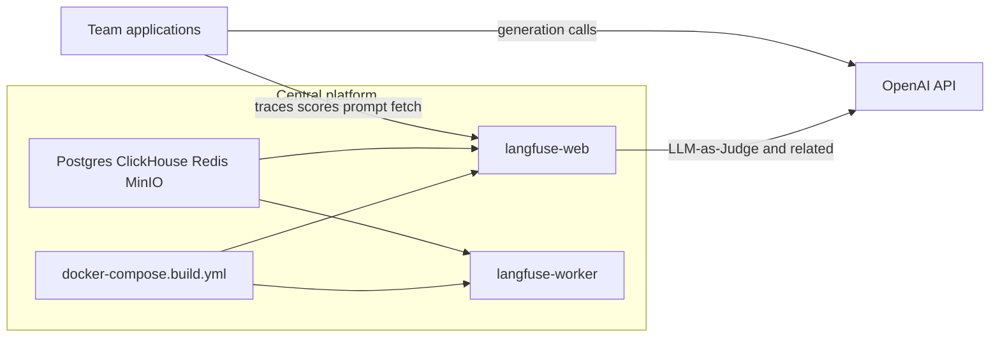

# Architecture overview

> **Start with product intent:** [Product intent and architecture](product-intent.md) — why this platform exists (central observability + agent evaluations) and how the system fits together.

## System context

The central team owns and runs **one shared Langfuse deployment** built from this repository (Langfuse **4.4.0** source). Application teams connect with API keys; they do not run their own Langfuse stacks.

## Components (Compose)

| Service | Role |
|---------|------|
| `langfuse-web` | UI + API (built from `web/Dockerfile`) |
| `langfuse-worker` | Async jobs / eval execution (built from `worker/Dockerfile`) |
| Postgres | Primary app metadata |
| ClickHouse | Analytics / trace storage path |
| Redis | Queues / cache |
| MinIO | S3-compatible blob storage for events/media |

Deploy details: [Operations — deploy](../operations/deploy.md).

## AI resource

**OpenAI** is the standard LLM provider:

- Apps call OpenAI directly (or via your gateway) and send telemetry to Langfuse  
- Langfuse uses OpenAI for LLM-as-a-Judge and other in-product LLM features when configured  

## Trust boundary

- Central team: infrastructure, upgrades, org/project bootstrap, shared LLM connection for judges  
- App teams: instrumentation quality, datasets for their use cases, prompt content for their products  

## Related guidelines

- [Product intent and architecture](product-intent.md)  
- [Observability](../observability/overview.md)  
- [Evaluation](../evaluation/overview.md) · [Agent evaluation](../evaluation/agent-evaluation.md)  
- [Prompt management](../prompt-management/overview.md)  
