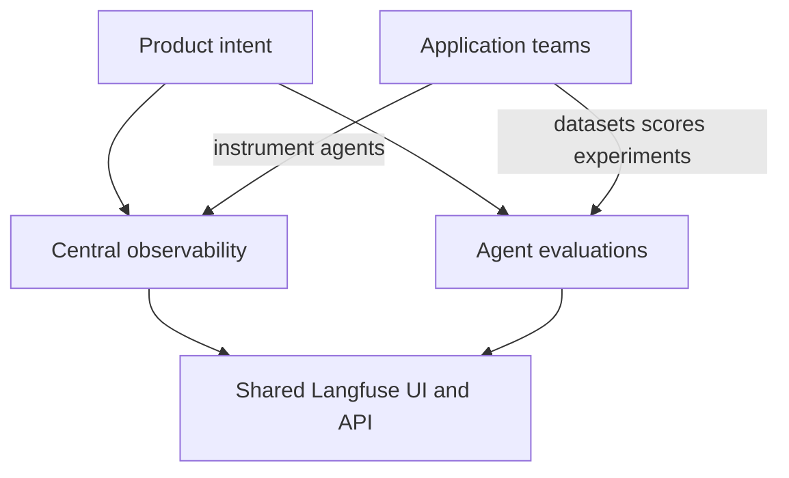
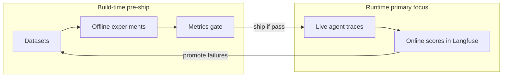
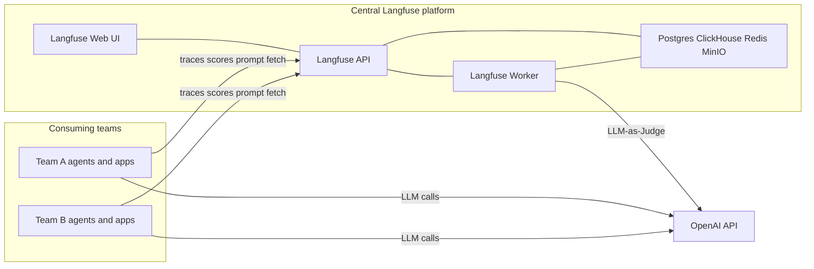
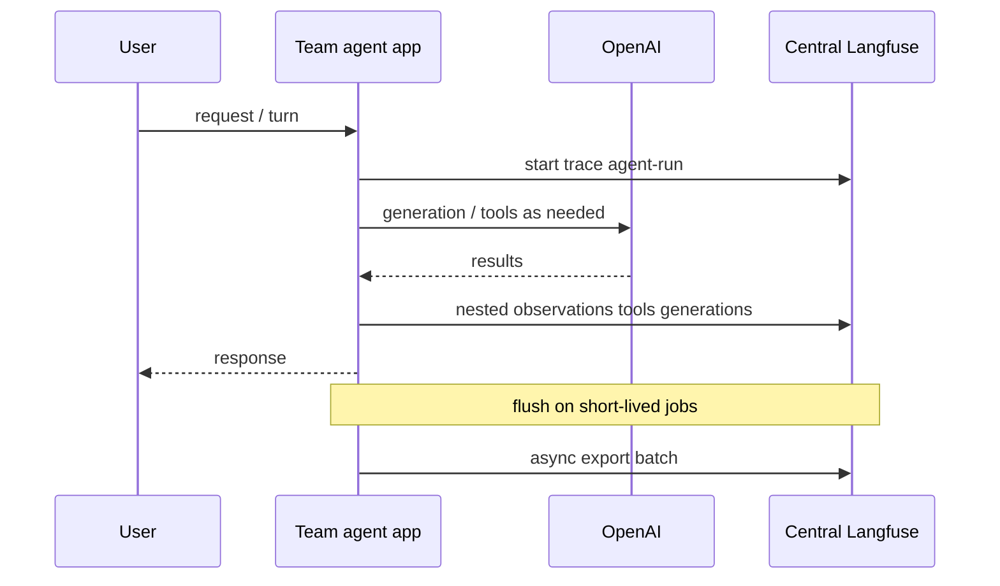
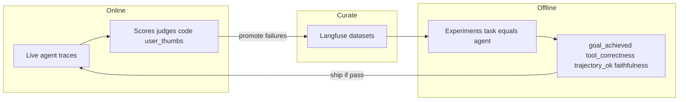
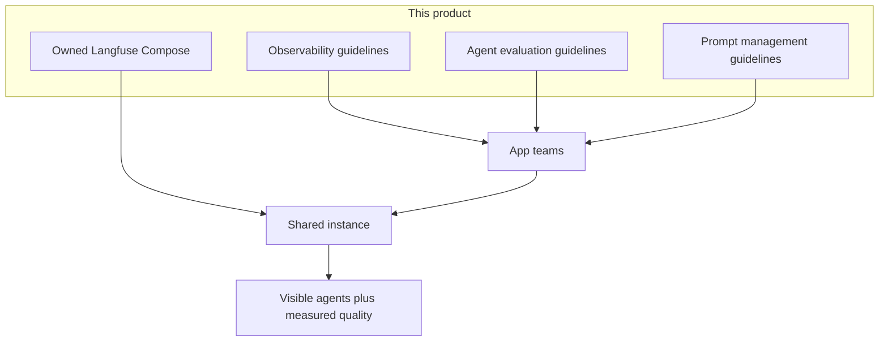

# Product intent and architecture

**Document type:** Product / architecture overview  
**Audience:** Central platform, engineering leads, app teams adopting Langfuse  
**Based on:** Langfuse 4.4.0 (owned source in this repository)

## 1. Intent

We package and operate **Langfuse as a central product** so every team can:

1. **Central observability** — one shared place to see traces, tool calls, latency, and cost for LLM and agent apps  
2. **Agent evaluations** — standard metrics and methods (offline experiments + online scoring) to judge whether agents achieve goals, use tools correctly, and stay safe  

Teams **do not** each deploy Langfuse. The central team runs the platform; app teams **plug in** with API keys and follow org guidelines for instrumentation and evaluation.

Prompt management is supported on the same instance; this document focuses on the two primary outcomes above.

## 2. Why this product exists

| Problem without a central platform | What this product provides |
|------------------------------------|----------------------------|
| Each team invents its own logging or skips tracing | Shared traces with org conventions (tags, environments, nesting) |
| Agent quality is “vibe checked” in production | Repeatable offline experiments + online scores |
| No common metric names | [Score catalog](../evaluation/score-catalog.md) (`goal_achieved`, `tool_correctness`, …) |
| Judge / eval tooling duplicated per team | Shared Langfuse + OpenAI for LLM-as-a-Judge |
| Upstream-only images, no ownership | Controlled build from **this** repo (`docker-compose.build.yml`) |

## 3. Agentic observability (build-time vs runtime)

Agent systems are non-deterministic: plans, tools, and LLM calls can fail in ways that only show up when the agent actually runs. **Agentic observability** is how we see and improve that behavior over time.

We distinguish two phases:

| Phase | What it covers | In this product |
|-------|----------------|-----------------|
| **Build-time** | Checks before ship — datasets, offline experiments, CI gates, code/LLM judges on fixed cases | Supported via Langfuse **datasets** and **experiments** (see [agent evaluation](../evaluation/agent-evaluation.md)) |
| **Runtime** | Live production / staging behavior — traces, online scores, sessions, cost | **Primary focus** — Central Langfuse tracing + online scoring |

**We focus mainly on runtime.** Langfuse is the shared place where team apps export nested agent traces (spans, tools, generations), attach online scores (LLM-as-a-Judge, code, user thumbs), and review failures. Build-time work still matters (offline experiments on gold cases before you change prompts or tools), but it feeds from and returns to the same runtime traces.

What runtime observability on Central Langfuse gives teams:

- End-to-end **traces** of agents, tools, and OpenAI generations  
- Scores and reviews for quality and safety on live traffic  
- Shared UI/API so every team uses the same conventions  

### How the dataset is created

The **dataset** in the build-time lane is a Langfuse collection of fixed test cases for one agent or use case (for example `support-agent-core`). It does not appear magically from infra — app teams curate it on the central project.

**1. Seed (gold cases)**  
Before or just after first ship, create a dataset in the Langfuse UI (or SDK). Add a small set of realistic scenarios by hand: typical user goals, edge cases you already know, and any scripted acceptance checks. For tool-using agents, store structured `input` (e.g. `user_goal`) and optional `expected_output` (`expected_tools`, `answer_contains`) so code evaluators can assert path and outcome. See [datasets and experiments](../evaluation/datasets-and-experiments.md).

**2. Grow from runtime (promote failures)**  
This is the main ongoing source. On Central Langfuse you review live traces and online scores (failed judge, bad `tool_correctness`, thumbs-down, loops, goal drift). For each important failure:

1. Open the trace (user input, tools used, final answer)  
2. Add a **dataset item** from that scenario — copy the user goal into `input`; optionally set expected tools / expected answer once you know the correct behavior  
3. Keep the item in the same use-case dataset so the next offline experiment covers it  

Langfuse supports adding items from production traces in the UI; teams can also create items via the SDK. Prefer the shared central project so every experiment run stays comparable.

**3. Use at build-time**  
Before changing prompts, models, or tools, run an **experiment**: your agent as the task over every dataset item, scored with catalog metrics (`goal_achieved`, `tool_correctness`, `trajectory_ok`, `faithfulness`, …). Ship only if the gate passes. Optional CI can fail the build on regressions.

**Org rules of thumb**

| Do | Don’t |
|----|--------|
| One dataset per major agent / use case | Mix unrelated products in one dataset |
| Start small (10–30 gold items), grow from real failures | Wait for a perfect suite before tracing production |
| Same score names online and offline | Invent one-off metric names per experiment |
| Promote hard / recurring failures, not every flaky blip | Silently edit items mid-comparison without noting it |

Infra (next section) is what runs that shared Langfuse instance.

## 4. System architecture

### 4.1 Context (C4-style)

### 4.2 Runtime components

Built and run from this repository via [Docker Compose build](../operations/deploy.md):

| Component | Responsibility |
|-----------|----------------|
| `langfuse-web` | UI + public/project API |
| `langfuse-worker` | Async ingestion jobs, eval execution |
| Postgres | App / project metadata |
| ClickHouse | Trace and analytics storage path |
| Redis | Queues and cache |
| MinIO | Object storage for events / media |
| OpenAI | App generation + in-product judges |

Detailed compose layout: [Architecture — components](overview.md).

### 4.3 Trust and ownership

| Role | Owns |
|------|------|
| **Central platform** | Instance uptime, upgrades, secrets, headless project bootstrap, shared OpenAI connection for judges, org docs |
| **App teams** | Instrumentation quality, datasets, prompts for their agents, product-side `OPENAI_API_KEY`, score usage per [catalog](../evaluation/score-catalog.md) |

## 5. Capability architecture

### 5.1 Central observability

**Intent:** Every agent request leaves a structured trail that humans and evaluators can trust.

**Org golden path**

- [Observability overview](../observability/overview.md)  
- [Get started](../observability/get-started.md) · [Best practices](../observability/best-practices.md) · [Instrumentation](../observability/instrumentation.md)  
- [Sessions](../observability/sessions.md) · [Environments](../observability/environments.md) · [Tags](../observability/tags-and-metadata.md)  

**Non-negotiables:** environment (`dev` / `staging` / `production`), tags `team` + `service`, nested tool and generation spans, meaningful root input/output.

### 5.2 Agent evaluations

**Intent:** Measure agent quality on the **same** traces and datasets, before and after shipping changes.

**Strategies** (see [Agent evaluation](../evaluation/agent-evaluation.md)):

| Strategy | Focus |
|----------|--------|
| Final response (black-box) | Goal / answer quality |
| Trajectory (glass-box) | Tool path and loops |
| Single step (white-box) | Unit-test one decision |

**Methods:** code evaluators, LLM-as-a-Judge (OpenAI), SDK scores, annotation — mapped in [evaluation overview](../evaluation/overview.md) and [LLM-as-Judge](../evaluation/llm-as-judge-and-openai.md).

## 6. How the pieces fit together

| Layer | Deliverable in this repo |
|-------|--------------------------|
| Platform | Langfuse 4.4.0 source + `docker-compose.build.yml` + `.env.example` + `scripts/org/up.sh` |
| Observability docs | `docs/observability/*` |
| Agent evaluation docs | `docs/evaluation/agent-evaluation.md`, `score-catalog.md`, experiments / judge guides |
| Prompt docs | `docs/prompt-management/*` |
| Onboarding | `docs/getting-started/plug-in.md`, root `README.md` |

## 7. Success criteria

The product is succeeding when:

1. Teams send production agent traces to the **central** instance with org tags and environments  
2. Agent changes are gated by **offline experiments** on shared datasets using catalog metrics  
3. **Online** scores (judge / code / thumbs) catch new failures and feed the dataset  
4. Platform upgrades ship from **this** repository’s controlled build, not ad-hoc Hub pulls alone  

## 8. Out of scope (for now)

- Sample agentic application in this repo (planned separately)  
- Per-team Langfuse deployments  
- Non-OpenAI default LLM for judges (OpenAI is the org AI resource)  

## 9. Related documents

| Document | Purpose |
|----------|---------|
| [Architecture — components](overview.md) | Compose services detail |
| [Operations — deploy](../operations/deploy.md) | How operators start/upgrade |
| [Docs index](../index.md) | Guideline entry points |
| [Agent evaluation](../evaluation/agent-evaluation.md) | Evaluation playbook |
| [Observability overview](../observability/overview.md) | Tracing golden path |
