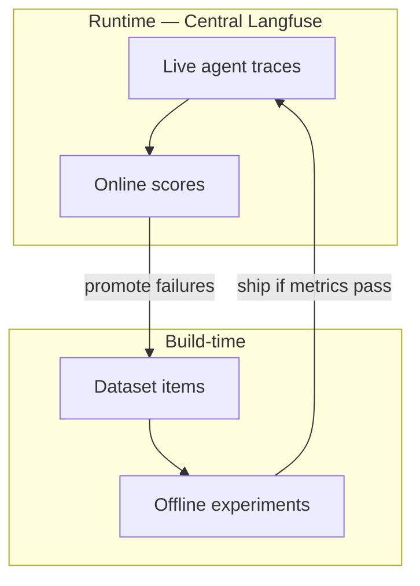

# Agent evaluation guidelines

Detailed golden path for **evaluating agents** on the central Langfuse instance. Agents are multi-step systems (plan → tools → final answer). Judging only the last message is not enough.

Official foundations: [Evaluation overview](https://langfuse.com/docs/evaluation/overview), [core concepts](https://langfuse.com/docs/evaluation/core-concepts). Agent patterns (framework-agnostic): [Agent Evaluation cookbook](https://langfuse.com/guides/cookbook/example_pydantic_ai_mcp_agent_evaluation).

Use the org [score catalog](score-catalog.md) for stable metric names.

## What agent evaluation is

An **agent run** is a trajectory: reasoning, tool calls, environment feedback, and a final response. Evaluation asks three questions:

1. **Did it achieve the goal?** (final response / outcome)  
2. **Did it take a sensible path?** (trajectory / tool selection)  
3. **Were individual decisions correct?** (single-step / white-box checks)

That requires nested [observability](../observability/instrumentation.md) so tools and generations appear as observations under one trace.

## Why it matters

Agents fail in ways single LLM calls do not: wrong tool, bad arguments, infinite loops, ignoring tool results, or a fluent but ungrounded final answer. Evaluation replaces guesswork with scores on the same central project every team uses, so you can compare prompt, model, and tool changes before and after ship.

## Three strategies (use together)

| Strategy | Also called | What you score | When |
|----------|-------------|----------------|------|
| Final response | Black-box | User input + final answer only | Fast regression; any framework |
| Trajectory | Glass-box | Sequence of tools / steps vs expected | Debug *why* the answer failed |
| Single step | White-box | One decision in isolation (next tool / args) | Unit-test planning and tool choice |

Org default for production agents: **final response + trajectory** offline; sample **final response** (and optional safety) online.

## Evaluation loop for agents

**Runtime is the primary focus** (live traces + online scores on Central Langfuse). Build-time offline experiments gate changes before ship.



1. **Runtime** — score live agent traces (LLM-as-a-Judge, code checks, user thumbs)  
2. **Curate** — add failing traces to a Langfuse dataset  
3. **Build-time** — run experiments (task = your agent) before changing prompts/models/tools  
4. **Compare** — same dataset, side-by-side experiment runs in the UI  
5. Repeat  

See [product intent — agentic observability](../architecture/product-intent.md#3-agentic-observability-build-time-vs-runtime).

## Prerequisite: structure traces for eval

```python
from langfuse import get_client

langfuse = get_client()

def run_agent(user_goal: str) -> str:
    with langfuse.start_as_current_observation(as_type="span", name="agent-run") as root:
        root.update_trace(
            tags=["your-team", "your-agent-service"],
            input=user_goal,
        )
        # plan / reason
        with langfuse.start_as_current_observation(as_type="span", name="plan") as plan:
            plan.update(output={"steps": ["search", "answer"]})

        # each tool
        with langfuse.start_as_current_observation(as_type="span", name="tool-search") as tool:
            result = {"hits": [...]}
            tool.update(input={"query": user_goal}, output=result)

        # final generation
        with langfuse.start_as_current_observation(
            as_type="generation", name="openai-final", model="gpt-4o-mini"
        ) as gen:
            answer = "..."  # OpenAI call
            gen.update(output=answer)

        root.update(output=answer)
        return answer
```

**Do:** one root span per agent run; name tools `tool-{name}`; tag `team` + `service`; use sessions for multi-turn agents.  
**Don’t:** flatten everything into one generation with no tool spans.

## Metrics (org catalog)

Use these score names everywhere (details in [score catalog](score-catalog.md)):

| Score | Type | Measures |
|-------|------|----------|
| `goal_achieved` | BOOLEAN | User goal solved |
| `tool_correctness` | BOOLEAN / NUMERIC | Right tools + args vs expected |
| `trajectory_ok` | BOOLEAN | Sensible path / no useless loops |
| `faithfulness` | NUMERIC (0–1) | Answer grounded in tool/context results |
| `harmful_content` | BOOLEAN | Safety / policy failure |
| `latency_budget` | BOOLEAN | End-to-end within SLA |
| `user_thumbs` | BOOLEAN | End-user feedback |

Pass defaults: `goal_achieved == true`, `trajectory_ok == true`, `faithfulness >= 0.7`, `harmful_content == false`, `latency_budget == true`.

## Method → agent use case

| If you want to… | Method | Typical metrics |
|-----------------|--------|-----------------|
| Review hard failures manually | [Annotation queues](https://langfuse.com/docs/evaluation/evaluation-methods/annotation-queues) / UI scores | ground truth labels |
| Enforce schema, required tools, max steps | [Code evaluators](https://langfuse.com/docs/evaluation/evaluation-methods/code-evaluators) | `tool_correctness`, `trajectory_ok`, `latency_budget` |
| Score helpfulness / faithfulness at scale | [LLM-as-a-Judge](llm-as-judge-and-openai.md) (OpenAI) | `goal_achieved`, `faithfulness`, `harmful_content` |
| Capture product feedback | [Scores via SDK](https://langfuse.com/docs/evaluation/evaluation-methods/scores-via-sdk) | `user_thumbs` |
| Compare agent versions before ship | [Experiments via SDK](datasets-and-experiments.md) | all of the above on a dataset |

## Offline playbook

### 1. Dataset item shape

Store agent scenarios in Langfuse datasets (one dataset per use case, e.g. `support-agent-core`):

```json
{
  "input": {
    "user_goal": "Reset my password and confirm email was sent",
    "context": { "locale": "en" }
  },
  "expected_output": {
    "expected_tools": ["lookup_user", "send_reset_email"],
    "answer_contains": ["reset", "email"]
  }
}
```

### 2. Task = run your agent

```python
from langfuse import get_client, Evaluation

langfuse = get_client()

def agent_task(*, item, **kwargs):
    payload = item.input if isinstance(item.input, dict) else {"user_goal": item.input}
    user_goal = payload["user_goal"]
    # Your agent — must emit nested Langfuse spans (see above)
    answer = run_agent(user_goal)
    # Return enough for evaluators (tools used if you capture them)
    return {
        "output": answer,
        "tools_used": getattr(run_agent, "last_tools", []),
    }
```

### 3. Code evaluators (deterministic)

```python
def tool_correctness(*, input, output, expected_output, **kwargs):
    expected = (expected_output or {}).get("expected_tools") or []
    if not expected:
        return Evaluation(name="tool_correctness", value=None, comment="no expected_tools")
    used = output.get("tools_used") or []
    ok = list(used) == list(expected)  # or set-equality if order free
    return Evaluation(name="tool_correctness", value=ok)

def trajectory_ok(*, input, output, expected_output, **kwargs):
    used = output.get("tools_used") or []
    # Example policy: no more than N tool calls, no consecutive duplicates
    if len(used) > 8:
        return Evaluation(name="trajectory_ok", value=False, comment="too many steps")
    for a, b in zip(used, used[1:]):
        if a == b:
            return Evaluation(name="trajectory_ok", value=False, comment="duplicate loop")
    return Evaluation(name="trajectory_ok", value=True)

def answer_contains(*, input, output, expected_output, **kwargs):
    needles = (expected_output or {}).get("answer_contains") or []
    text = str(output.get("output", "")).lower()
    ok = all(n.lower() in text for n in needles) if needles else None
    return Evaluation(name="goal_achieved", value=ok)
```

### 4. LLM-as-a-Judge (OpenAI) for subjective metrics

Configure judges on the central instance for `faithfulness` and narrative `goal_achieved` — see [LLM-as-Judge and OpenAI](llm-as-judge-and-openai.md). Prefer the same score names online and offline.

### 5. Run and compare

Use the [Experiments SDK](https://langfuse.com/docs/evaluation/experiments/experiments-via-sdk) (exact helper names vary by SDK version):

```python
# Pseudocode — confirm against current SDK docs
# dataset = langfuse.get_dataset("support-agent-core")
# langfuse.run_experiment(
#     name="agent-prompt-v3",
#     data=dataset.items,
#     task=agent_task,
#     evaluators=[tool_correctness, trajectory_ok, answer_contains],
# )
```

In the UI, compare experiment runs on the **same dataset**. Inspect failing items’ full traces (tools + generations).

## Online playbook

1. Filter production traces by tag `your-agent-service` and environment `production`  
2. Attach LLM-as-a-Judge on final generations (sample, e.g. 5–10%, to control OpenAI cost) for `faithfulness` / `harmful_content`  
3. Optionally run light code checks (max steps, tool error flags) via worker/SDK  
4. Collect `user_thumbs` from the product with `create_score`  
5. Weekly: open low-scoring traces → add to the offline dataset  

```python
from langfuse import get_client

langfuse = get_client()

def record_user_feedback(trace_id: str, thumbs_up: bool):
    langfuse.create_score(
        name="user_thumbs",
        value=1 if thumbs_up else 0,
        data_type="BOOLEAN",
        trace_id=trace_id,
    )
```

## What good looks like in the UI

- Traces show nested `agent-run` → `tool-*` → `openai-final`  
- Experiment table shows columns for `goal_achieved`, `tool_correctness`, `trajectory_ok`, `faithfulness`  
- Score analytics trend those names over time for `production`  
- Failures are one click from the score to the full trajectory  

## Do / don’t

**Do**

- Evaluate trajectory and tools, not only the final string  
- Reuse [score catalog](score-catalog.md) names  
- Grow datasets from production failures  
- Sample expensive judges in production  

**Don’t**

- Ship agent prompt/model changes with no offline experiment  
- Treat one LLM-judge score as absolute truth without spot checks  
- Invent one-off score names per PR  
- Leave agents untraced (eval without spans is guesswork)  

## Related

- [Score catalog](score-catalog.md)  
- [Evaluation overview](overview.md)  
- [Datasets and experiments](datasets-and-experiments.md)  
- [LLM-as-Judge and OpenAI](llm-as-judge-and-openai.md)  
- [Observability instrumentation](../observability/instrumentation.md)  
