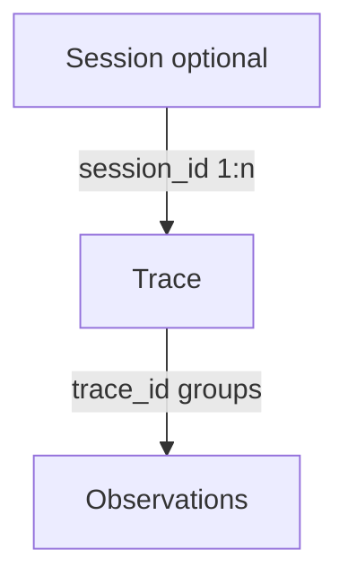

# Data model — traces, observations, sessions

How Langfuse structures your data. Understanding this makes debugging and evaluation easier.

Official: [Core concepts / data model](https://langfuse.com/docs/observability/data-model).

## The three levels

| Concept | Meaning | Example |
|---------|---------|---------|
| **Observation** | One step: LLM call, tool call, retrieval, custom span | `openai-chat`, `tool-search` |
| **Trace** | One request / turn / agent run — all observations sharing a `trace_id` | User asks a question → final answer |
| **Session** | Optional group of traces for one multi-turn interaction | A chat thread |

Trace-level attributes (`user_id`, `session_id`, `tags`, `metadata`, `environment`) are associated with the trace and available for filtering; SDKs can propagate them to child observations.

## Observation types we use

Use the correct type so cost, evaluators, and filters work.

| Type | Use for | Notes |
|------|---------|-------|
| `span` | Generic step, orchestration, retrieval wrapper | Default container |
| `generation` | LLM calls (OpenAI, etc.) | Carry **model**, **usage**, **cost** |
| `tool` / name `tool-*` | Tool / function executions | Targetable by judges and filters |

Framework integrations often set types automatically. When instrumenting manually, pass `as_type="generation"` (or the SDK’s tool type if available). See [observation types](https://langfuse.com/docs/observability/features/observation-types).

## Attributes you attach

| Attribute | Purpose | Guide |
|-----------|---------|--------|
| [Environments](environments.md) | `dev` / `staging` / `production` | Separate stages |
| [Tags](tags-and-metadata.md) | Team, service, feature | Filter and dashboards |
| [Sessions](sessions.md) | Multi-turn grouping | Session replay |
| User ID | Per-user views / cost | Official [users](https://langfuse.com/docs/observability/features/users) |
| Metadata | Request IDs, flags, raw payloads | [Tags and metadata](tags-and-metadata.md) |

## How capture works (background)

Langfuse is built on **OpenTelemetry**. Instrumentation records events; the SDK **batches** them and exports in the background so your app stays fast.

- **Long-running servers** — exporter runs continuously  
- **Short-lived scripts** — you **must** `flush()` before exit or traces are lost  

Details: [queuing and batching](https://langfuse.com/docs/observability/features/queuing-batching). Multi-destination OTel setups: [OpenTelemetry integration](https://langfuse.com/docs/opentelemetry/get-started) (optional; not required for the org golden path).

## What good looks like

- Trace tree shows nested steps with correct types  
- One logical unit of work per trace; multi-turn uses sessions  
- Attributes set so you can filter by environment + service  

## Do / don’t

**Do** learn nesting and naming in [best practices](best-practices.md) before scaling instrumentation.  
**Don’t** treat every HTTP/DB span as useful — filter noise when frameworks add clutter.

## Related

- [Get started](get-started.md)  
- [Best practices](best-practices.md)  
- [Instrumentation](instrumentation.md)  
- [Sessions](sessions.md)  
