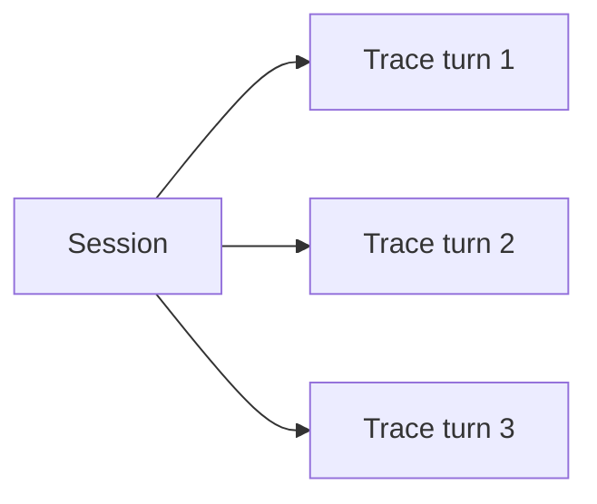

# Sessions

Group related traces into a **session** for multi-turn chats or multi-step workflows, and replay the full interaction in the UI.

Official: [Sessions](https://langfuse.com/docs/observability/features/sessions).

## What and why

Many LLM interactions span multiple traces (each user message is a new turn). A **session** ties those traces together with a shared `session_id` so you can:

- Replay the conversation  
- Annotate or score at session level  
- Debug context/memory issues across turns  



## When to use sessions

**Use when**

- Chatbots / assistants (one trace per turn, one session per conversation)  
- Multi-agent workflows that contribute to one user-facing outcome  
- Human-in-the-loop flows that span multiple requests  

**Skip when**

- Single request → single response with no continuity  

## How to implement

`session_id` must be a US-ASCII string under 200 characters (longer IDs are dropped). Propagate the same ID on every turn.

```python
from langfuse import get_client, propagate_attributes

langfuse = get_client()

SESSION_ID = "user-123-session-abc"  # stable for the conversation
USER_ID = "user-123"

def handle_turn(user_message: str) -> str:
    with langfuse.start_as_current_observation(as_type="span", name="chat-turn") as root:
        with propagate_attributes(session_id=SESSION_ID, user_id=USER_ID):
            root.update_trace(
                tags=["your-team", "chatbot"],
                input=user_message,
            )
            # nested generations / tools here
            answer = "..."  # your OpenAI / agent logic
            root.update(output=answer)
            return answer

# After scripts / batch jobs:
# langfuse.flush()
```

You can also set `session_id` via `update_trace(...)` if you are not using `propagate_attributes`. Prefer propagation so all nested observations inherit the session.

## How to use in the UI

1. Open **Sessions** in the central Langfuse project  
2. Select a session to see turns in order  
3. Drill into a turn’s trace for tools and generations  

Optional: bookmark, publish, or annotate sessions; add session-level scores from feedback forms ([scores via SDK](https://langfuse.com/docs/evaluation/evaluation-methods/scores-via-sdk)).

## What good looks like

- Each turn is its own trace with clear input/output  
- All turns share one `session_id` and usually one `user_id`  
- Session replay reads as a coherent conversation  

## Do / don’t

**Do** create a new `session_id` per conversation; reuse it for every turn.  
**Don’t** put secrets in session IDs.  
**Don’t** put an entire multi-turn chat into a single giant trace when sessions fit better.

## Related

- [Best practices](best-practices.md) (trace vs session scope)  
- [Data model](data-model.md)  
- [User feedback / `user_thumbs`](../evaluation/score-catalog.md)  
- Evaluating conversations: [multi-turn cookbook](https://langfuse.com/guides/cookbook/example_evaluating_multi_turn_conversations)  
